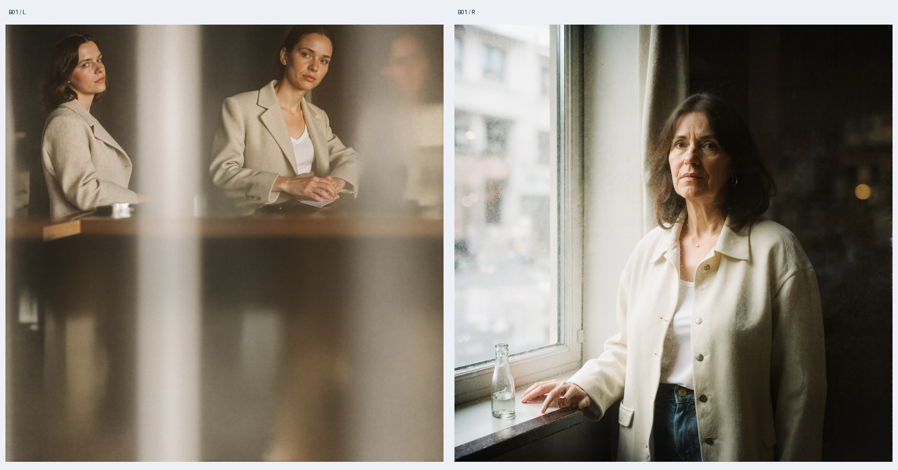

# ComfyUI-AReA

[简体中文](README.zh-CN.md) · [Workflows](workflows/README.md) · [Test evidence](TESTING.md) · [Release notes](RELEASE_NOTES.md) · [Final local audit](validation/final_audit.json)

Experimental independent ComfyUI port of **AReA: Adaptive Receptive-Field Attention for Efficient High-Resolution Diffusion Transformers**. This port integrates the two attention phases into native ComfyUI FLUX.1 sampling through a MODEL → MODEL patch node.

**Public version: `0.1` — experimental prerelease.** The inference code is identical to internal local builds 0.1.1 / 0.1.2; those numbers are local development history, not public releases. This version adds public documentation, portable annotated workflows and normalized historical test records. [Download v0.1](https://github.com/VividMuse-AGI/ComfyUI-AReA/releases/tag/v0.1). No Comfy Registry entry is provided.

## What has been demonstrated

- Full FLUX.1-Krea-dev FP8 scaled checkpoint: successful 2048×2048 / 28-step generation and 4096×4096 / 28-step ON/OFF comparisons.
- Two repeated 4K pairs on **RTX 5080 16GB**: median sampling time **958.24 s OFF → 528.66 s ON**; median paired speedup **1.81×**. Whole-workflow medians were 981.48 s and 551.71 s. Results depend on the recorded host and launch configuration.
- **Stable VRAM savings were not established.** Median whole-card sampling peaks were 14.52 / 14.53 GiB; PyTorch allocated peaks were 5.78 / 6.75 GiB (OFF / ON).
- Visual coverage is one cafe-window portrait prompt and one seed. Hands and white specks remain problematic; the attention change also changes composition and apparent identity. These results do not establish a general quality improvement.

This is a downscaled overview of an existing test pair. Full-resolution outputs and continuous telemetry are retained in the original local test archive, and are not bundled here. Recorded output hashes and per-run metrics are included. See [TESTING.md](TESTING.md) for scope and limitations.

## Installation

1. Extract this repository folder as `ComfyUI/custom_nodes/ComfyUI-AReA/`. Its `__init__.py` must be directly inside that folder. Move any old copy outside `custom_nodes` before replacing it, to prevent duplicate loading.
2. Use a ComfyUI version with FLUX `post_input`, `attn1_patch`, `optimized_attention_override`, diffusion wrappers and `sample_sigmas` support. The full-checkpoint tests used **ComfyUI v0.40.0**, commit `3541246a9c997f4b8c32f9f88f3c985d02021c79`, Python 3.11.9 and torch 2.9.1+cu130. The source API reference is pinned in [TESTING.md](TESTING.md). Compatibility with every historical or future ComfyUI version is unverified.
3. A normal ComfyUI environment already provides torch, numpy and Pillow. If a package is missing, install it using the Python interpreter that actually launches ComfyUI. Avoid reinstalling CUDA/PyTorch just for this node.
4. Restart ComfyUI and search for `AReA`.

The node does not download models or install software. Model weights are separate and keep their own licenses.

## Models and supported scope

The adapter targets standard native **FLUX.1-Krea-dev / FLUX.1-dev text-to-image architecture**. Full-checkpoint acceptance was performed with Krea FP8 scaled, not every FLUX.1 checkpoint or precision. Krea 2, FLUX.2, Qwen-Image and Kontext editing are outside the current adapter scope.

| Loader | Example filename used by the workflows | ComfyUI model directory |
|---|---|---|
| Load Diffusion Model / `UNETLoader` | `flux1-krea-dev_fp8_scaled.safetensors` | `models/diffusion_models/` |
| Load CLIP (Dual) / `DualCLIPLoader` | `clip_l.safetensors`, `t5xxl_fp8_e4m3fn.safetensors` | `models/text_encoders/` |
| Load VAE / `VAELoader` | `ae.safetensors` | `models/vae/` |

**After importing a workflow, reselect all installed model files in these three loaders.** The files use basenames to avoid machine-specific subfolders. If your models are inside subfolders, choose the entries actually listed by ComfyUI. Original model: [FLUX.1-Krea-dev](https://huggingface.co/black-forest-labs/FLUX.1-Krea-dev). No weights are included, and a multi-shard Diffusers checkpoint cannot be selected as one native single-file weight.

## Annotated workflows

| Workflow | Canvas | AReA |
|---|---|---|
| [2K ON](workflows/01_Krea_FP8_2K_AReA_ON.json) | 2048×2048 | enabled |
| [4K ON](workflows/02_Krea_FP8_4K_AReA_ON.json) | 4096×4096 | enabled |
| [4K OFF control](workflows/03_Krea_FP8_4K_AReA_OFF.json) | 4096×4096 | disabled |

Start with 2K. Drag a non-`_API` JSON into ComfyUI. Chinese-annotated copies are in [workflows/zh-CN/](workflows/zh-CN/01_Krea_FP8_2K_AReA_ON.json); each UI file has a matching `_API.json` for programmatic submission. All six UI workflows keep the default node names and use standard Note nodes plus colored groups. Node display text supplied by this plugin is currently Chinese in both workflow languages.

| Change | Node / field |
|---|---|
| Prompt | Populated `CLIPTextEncode`, node 5; keep the second blank encoder empty initially |
| Noise seed | `KSampler`, node 9 → `seed`; keep `control_after_generate=fixed` |
| AReA randomness | `AReAFluxPatch`, node 3 → `seed`; set it to the same value for a controlled comparison |
| Resolution | Change `width` / `height` in **both** `ModelSamplingFlux` (2) and `EmptySD3LatentImage` (8) |
| AReA switch | `AReAFluxPatch`, node 3 → `enabled`: true ON, false OFF |

Defaults: batch=1, 28 steps, Euler/simple, KSampler CFG=1, FluxGuidance=4.5, denoise=1, fixed `max_shift=base_shift=1.15`, tiled VAE 512/64. Keep the same prompt, both seeds and all sampling settings when comparing ON/OFF. The public copies preserve the tested graph and numeric settings; model selections and explanatory notes have been normalized. They have not been used for new image generation.

For an existing native Krea workflow, connect `MODEL → ModelSamplingFlux → AReAFluxPatch → KSampler`. The patch preserves the sampler and model weights. Workflow shift=1.15 matches the upstream FLUX adapter; changing to a resolution-dependent shift creates different experimental conditions.

## Patch parameters

| Parameter | Default | Meaning |
|---|---:|---|
| `enabled` | true | Apply AReA; false returns a model clone without adding this patch |
| `phase1_steps` | 0 | Automatically allocate about 8/28 of actual steps to the coarse phase; manual values must be 1…actual_steps−1 |
| `pooling` | subsample | Coarse K/V representative: subsample, mean, medoid or random |
| `halo` | 8 | Maximum neighboring token halo width |
| `bridge_ratio` | 0.5 | Global bridge-token ratio; 0 disables bridging |
| `seed` | 0 | Window jitter / random pooling seed |
| `window_batch_size` | 1 | Windows per attention call; increasing this may trade temporary memory for speed |

Automatic splits: 2→1+1, 4→1+3, 8→2+6, 28→8+20. A single high-resolution step is rejected. Progress follows actual sigma intervals, which avoids counting repeated model evaluations as extra steps. Few-step execution does not demonstrate good Krea-dev image quality or compatibility with acceleration LoRAs.

Prefer dimensions divisible by 32. FLUX.1 uses one image token per 16×16 pixels; at high resolution, the two token-axis counts must share a divisor of at least 2. Native-size grids with both axes ≤64 tokens use original attention. Unsupported dimensions produce an error instead of resizing silently.

## Fixes and known limits

- Per-image content statistics, window layouts and bridge selection prevent unrelated batch items from sharing their content decisions. Batch equivalence was checked with small random host models; full-checkpoint batch acceptance remains outstanding.
- `AReASaveImage` uses timestamp + UUID filenames and exclusive creation to prevent overwrites, including collisions and concurrent saves. It preserves PNG prompt/workflow metadata unless metadata is disabled. The filename prefix cannot specify a subdirectory. ComfyUI's standard Save Image can also be connected.
- The patch uses model-local ComfyUI APIs without globally replacing attention functions or changing model weights. Conflicting attention/RoPE/block patches, reference tokens and custom masks are rejected.
- LoRA combinations, GGUF/NF4, torch.compile, multi-GPU, ControlNet and IPAdapter have not received full acceptance testing. Place ordinary weight LoRAs before the patch when experimenting.
- Bootstrap mode from upstream is not implemented. This node generates at the requested canvas size; it is not a standalone upscaler. No comparison against low-resolution generation followed by upscaling has been completed.
- Full-resolution QKV and MLP work remains. Tiled VAE reduces decode pressure only. Window batching and CPU offload affect performance; no broad 16GB or lower-VRAM guarantee is made.
- Multi-prompt, multi-seed, aspect-ratio and image-editing validation remains incomplete. The extension depends on ComfyUI attention hooks, so host updates may require adapter changes.

For missing nodes, check the installation folder and import log. For invalid model names, reselect your installed files. For memory pressure, begin with 2K, batch=1 and `window_batch_size=1`. For patch conflicts, test the included graph before adding other extensions.

## Development and attribution

CPU-only validation instructions are in [TESTING.md](TESTING.md); contribution guidance is in [CONTRIBUTING.md](CONTRIBUTING.md). The included GitHub Actions workflow runs static checks and CPU tests on pushes and pull requests; see [Actions](https://github.com/VividMuse-AGI/ComfyUI-AReA/actions) for current results. No release-publishing workflow is included.

Algorithm and modified core source originate from [KooroshRH/AReA](https://github.com/KooroshRH/AReA), by Javad Rajabi, Koorosh Roohi, David B. Lindell and Babak Taati. See the [project page](https://rajabi2001.github.io/area/), [LICENSE](LICENSE) and [NOTICE](NOTICE). This is an independent community port, not an official release from the AReA authors or ComfyUI team. Source is distributed under Apache-2.0; model licenses are separate.
